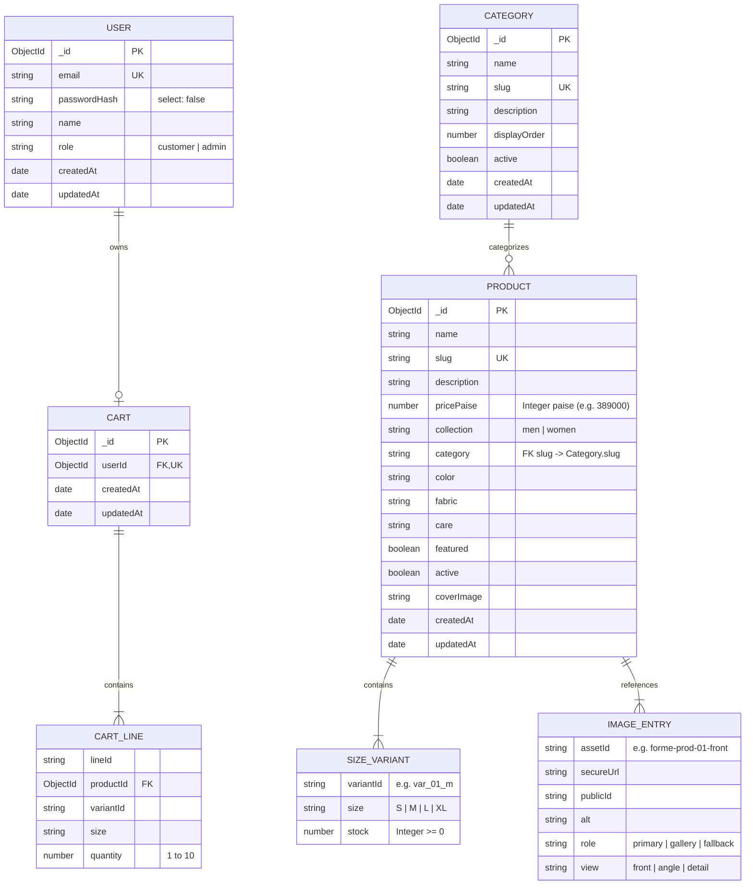

# FORME Clothing E-Commerce — Database Schema & Data Model Documentation

This document describes the persistence layer, data models, schema rules, indexing strategies, and relationships implemented in MongoDB for the FORME E-Commerce platform.

---

## 1. Architectural Principles

1. **Integer Minor Unit Currency Precision (`pricePaise`)**:
   All monetary amounts are strictly persisted as integer minor units (paise: 1 INR = 100 paise) to prevent IEEE-754 floating-point rounding errors during tax, discount, or subtotal calculations.
2. **Normalized Taxonomy with Embedded Variants**:
   Clothing categories and customer identities are normalized top-level collections. Size variants (`sizes`) and photographic assets (`images`) are embedded within the `Product` document for atomic inventory updates and sub-millisecond single-roundtrip queries.
3. **Strict Credential Segregation**:
   The `User` model hides sensitive password hashes by default (`select: false`), enforcing that authentication secrets never leak into general queries or client payloads.
4. **Server-Enforced RBAC**:
   User roles are constrained strictly to `'customer'` and `'admin'`. Role escalation through client payloads is prohibited by server validation.

---

## 2. Entity-Relationship Diagram (ERD)

---

## 3. Data Models Specification

### 3.1 User Model (`server/src/models/User.js`)

Represents registered shoppers and store administrators.

| Field | Type | Validation / Rules | Description |
|---|---|---|---|
| `_id` | `ObjectId` | Auto-generated | Primary Key |
| `email` | `String` | Required, unique, lowercase, trimmed, regex format | Login identity and notification address |
| `passwordHash` | `String` | Required, `select: false` | BCrypt salted hash (10 salt rounds) |
| `name` | `String` | Optional, trimmed, max 100 chars | Customer full display name |
| `role` | `String` | Enum: `['customer', 'admin']`, default: `'customer'` | Role for authorization middleware |
| `createdAt` | `Date` | Timestamp | Account creation timestamp |
| `updatedAt` | `Date` | Timestamp | Account update timestamp |

**Indexes**:
- `{ email: 1 }` (Unique, Sparse: false)

**Methods**:
- `comparePassword(candidatePassword)`: BCrypt constant-time hash comparison.
- `toPublicJSON()`: Sanitized DTO projection stripping `passwordHash` and internal keys.

---

### 3.2 Product Model (`server/src/models/Product.js`)

Represents curated clothing catalog merchandise.

| Field | Type | Validation / Rules | Description |
|---|---|---|---|
| `_id` | `ObjectId` | Auto-generated | Primary Key |
| `name` | `String` | Required, trimmed, max 150 chars | Display title (e.g., "Relaxed Linen Camp Shirt") |
| `slug` | `String` | Required, unique, lowercase, trimmed | URL path identifier (e.g., `men-relaxed-linen-shirt-ivory`) |
| `description` | `String` | Required, trimmed | Detailed editorial garment description |
| `pricePaise` | `Number` | Required, integer, min: 100 | Unit price in paise (₹3,890.00 = `389000`) |
| `collection` | `String` | Required, Enum: `['men', 'women']` | Target wardrobe gender classification |
| `category` | `String` | Required, lowercase, trimmed | Category slug foreign key |
| `color` | `String` | Trimmed | Garment color name (e.g., "Warm Ivory") |
| `fabric` | `String` | Trimmed | Textile specification (e.g., "100% French Washed Linen") |
| `care` | `String` | Trimmed | Washing and maintenance instructions |
| `sizes` | `[SizeVariant]` | Array of variants (at least 1 required) | Size stock breakdown (S, M, L, XL) |
| `images` | `[ImageEntry]` | Array of image assets | Frontal, movement, and textile detail shots |
| `coverImage` | `String` | Optional assetId | Primary catalog grid card photo identifier |
| `featured` | `Boolean` | Default: `false` | Highlighted on homepage featured carousel |
| `active` | `Boolean` | Default: `true` | Visibility flag (soft-delete / archival) |

#### Embedded Sub-Document: `SizeVariant`
| Field | Type | Description |
|---|---|---|
| `variantId` | `String` | Unique variant slug within product (`var_01_m`) |
| `size` | `String` | Garment size descriptor (`S`, `M`, `L`, `XL`) |
| `stock` | `Number` | Integer count of remaining inventory units (`>= 0`) |

#### Embedded Sub-Document: `ImageEntry`
| Field | Type | Description |
|---|---|---|
| `assetId` | `String` | Manifest identifier (`forme-prod-01-front`) |
| `secureUrl` | `String` | Cloudinary CDN or local static URL |
| `publicId` | `String` | Cloudinary asset public ID |
| `alt` | `String` | Accessible screen-reader alt text |
| `role` | `String` | Enum: `primary`, `gallery`, `fallback` |
| `view` | `String` | Photographic angle: `front`, `angle`, `detail` |

**Indexes**:
- `{ slug: 1 }` (Unique)
- `{ collection: 1, active: 1, createdAt: -1 }` (Storefront collection listing)
- `{ category: 1, active: 1, pricePaise: 1 }` (Filtered category browsing)
- `{ name: 'text', description: 'text', color: 'text', fabric: 'text' }` (Text search)

**Virtuals**:
- `totalStock`: Dynamically computes sum of all size variant stocks.

---

### 3.3 Category Model (`server/src/models/Category.js`)

Defines the clothing taxonomy and navigation ordering.

| Field | Type | Validation / Rules | Description |
|---|---|---|---|
| `_id` | `ObjectId` | Auto-generated | Primary Key |
| `name` | `String` | Required, trimmed, max 80 chars | Category title (e.g., "Shirts", "Trousers") |
| `slug` | `String` | Required, unique, lowercase, trimmed | URL slug identifier (`shirts`, `trousers`) |
| `description` | `String` | Trimmed, max 300 chars | Category summary |
| `displayOrder` | `Number` | Default: `0`, indexed | Navigation sort priority |
| `active` | `Boolean` | Default: `true` | Active taxonomy toggle |

**Indexes**:
- `{ slug: 1 }` (Unique)
- `{ displayOrder: 1 }`
- `{ active: 1 }`

---

### 3.4 Cart Model (`server/src/models/Cart.js`)

Persists customer shopping bags for authenticated shoppers across sessions.

| Field | Type | Validation / Rules | Description |
|---|---|---|---|
| `_id` | `ObjectId` | Auto-generated | Primary Key |
| `userId` | `ObjectId` | Required, unique, Ref: `'User'` | Owner customer account |
| `lines` | `[CartLine]` | Array of cart items | Items in the shopping bag |
| `createdAt` | `Date` | Timestamp | Creation date |
| `updatedAt` | `Date` | Timestamp | Last modified date |

#### Embedded Sub-Document: `CartLine`
| Field | Type | Validation / Rules | Description |
|---|---|---|---|
| `lineId` | `String` | Required | Unique client line identifier |
| `productId` | `ObjectId` | Required, Ref: `'Product'` | Target product reference |
| `variantId` | `String` | Required | Target size variant reference |
| `size` | `String` | Required | Garment size (`S`, `M`, etc.) |
| `quantity` | `Number` | Required, Integer, min: 1, max: 10 | Units requested |

**Indexes**:
- `{ userId: 1 }` (Unique)

---

## 4. Seeding & Bootstrap Lifecycle

The application ships with automated idempotent seeding routines:

1. **Identity Seeding (`npm run seed:admin`)**:
   - Creates the initial Administrator account (`admin@forme-studio.com`).
   - Creates the Customer demo account (`customer@forme-studio.com`).
   - Uses `findOneAndUpdate` with `{ upsert: true }` to guarantee idempotency.
2. **Catalog Seeding (`npm run seed:db`)**:
   - Parses `data/catalog-blueprint.json` and cross-references `asset-manifest.json`.
   - Seeds 6 clothing categories with strict display orders.
   - Seeds 20 clothing products with 3 photographic angles each and size variant inventory counts.
   - Validates that every price is stored in integer paise.
